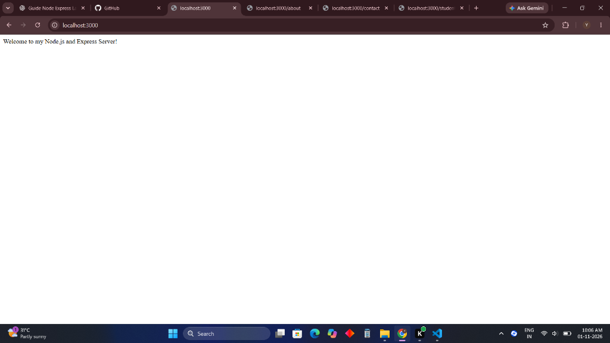
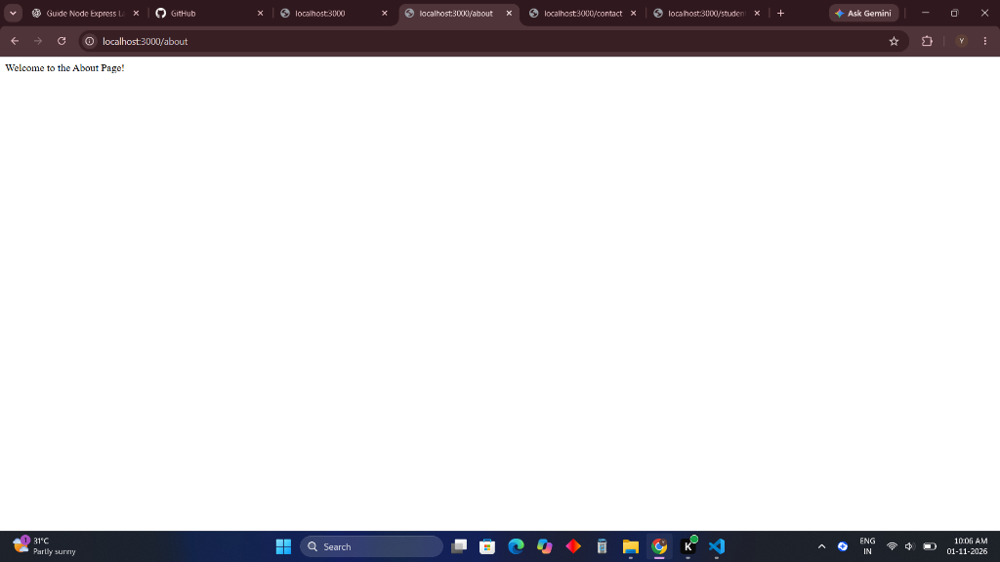
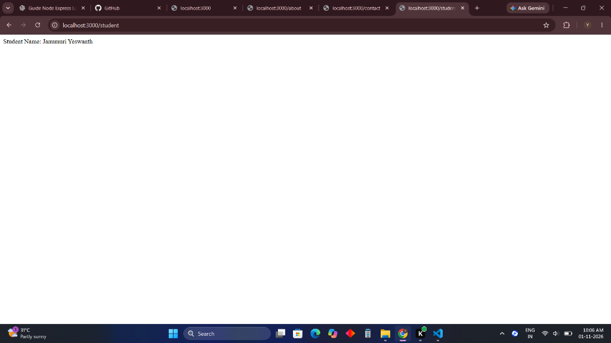
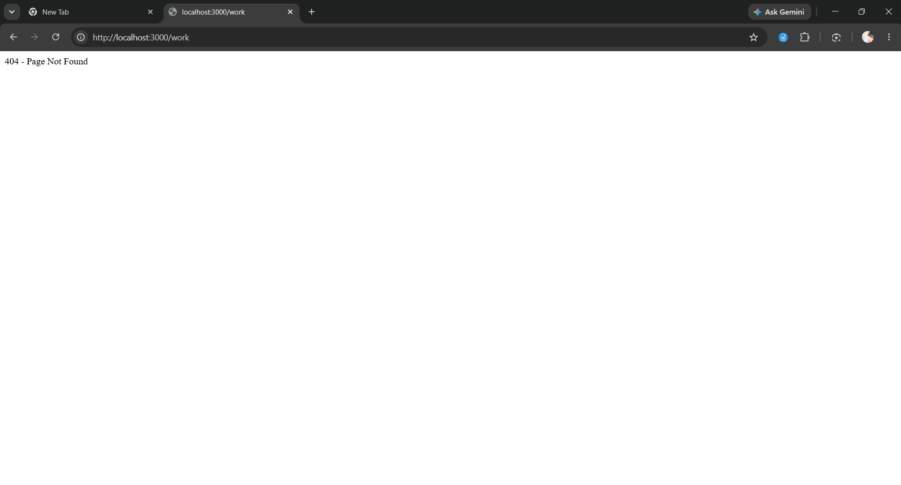

# Lab 1: Node.js and Express Server

## Student Details

- **Name:** Janumuri Yeswanth
- **Registration Number:** 252U1R9046
- **Section:** CSE-GEN-AI 2A
- **Course:** Backend Development Fundamentals
- **Lab Number:** 01
- **GitHub Repository:** [Backend_development_fundamentals_lab_01](https://github.com/janumuriyeswanth-blip/Backend_development_fundamentals_lab_01)

---

## Objective

To set up a Node.js project, build a basic HTTP server using the built-in `http` module, and implement an Express.js server with multiple REST routes, appropriate HTTP status codes, and error fallback handling.

---

## Technologies Used

- **Node.js** (v24.x)
- **Express.js** (v4.x / v5.x)
- **JavaScript / CommonJS**
- **npm** (Node Package Manager)

---

## Project Structure

```text
backend-fundamentals-lab-01/
├── screenshots/
│   ├── home.png                    # GET / response screenshot
│   ├── about.png                   # GET /about response screenshot
│   ├── student.png                 # GET /student response screenshot
│   ├── not-found.png               # 404 Not Found response screenshot
│   └── time.png                    # GET /time response screenshot
├── server-http.js                  # Built-in Node.js HTTP server
├── server.js                       # Express application server
├── test-endpoints.js               # Automated endpoint verification test script
├── package.json                    # Project metadata and dependencies
├── .gitignore                      # Git ignore rules
└── README.md                       # Lab documentation
```

---

## Installation and Setup

### Prerequisites

- Node.js and npm installed on your machine.
- Terminal / command prompt (PowerShell, Bash, or Command Prompt).

### Steps to Run

1. **Navigate to the project folder:**
   ```bash
   cd backend-fundamentals-lab-01
   ```

2. **Install dependencies:**
   ```bash
   npm install
   ```

3. **Start the Express server:**
   ```bash
   npm start
   # or: node server.js
   ```

4. **Access the server in your browser:**
   - Home: [http://localhost:3000/](http://localhost:3000/)
   - About: [http://localhost:3000/about](http://localhost:3000/about)
   - Student: [http://localhost:3000/student](http://localhost:3000/student)
   - Contact: [http://localhost:3000/contact](http://localhost:3000/contact)
   - Time: [http://localhost:3000/time](http://localhost:3000/time)
   - Unknown Route: [http://localhost:3000/anything](http://localhost:3000/anything)

### Run the Basic HTTP Server

```bash
npm run start:http
# or: node server-http.js
```

### Run Automated Endpoint Tests

```bash
npm test
```

---

## Endpoints

| Method | Endpoint | Description | Expected Status | Response Type |
|---|---|---|---|---|
| **GET** | `/` | Returns the server welcome message | `200 OK` | `text/plain` |
| **GET** | `/about` | Returns the about page greeting | `200 OK` | `text/plain` |
| **GET** | `/student` | Returns student details with student name | `200 OK` | `text/plain` |
| **GET** | `/contact` | Returns the contact page message | `200 OK` | `text/plain` |
| **GET** | `/time` | Returns the server's current date and time | `200 OK` | `application/json` |
| **GET** | `/*` (undefined) | Fallback wildcard middleware for unknown routes | `404 Not Found` | `text/plain` |

---

## Screenshots

### 1. Home Route (`/`)
Displays the welcome message.



### 2. About Route (`/about`)
Displays the about page message.



### 3. Student Route (`/student`)
Displays the student's name and details.



### 4. Unknown Route (`/anything`)
Displays the 404 Page Not Found error message.



---

## HTTP Status Codes

- **`200 OK`:** The request succeeded and the server returned the requested resource.
- **`404 Not Found`:** The server could not find a matching route for the requested URL path.

---

## Viva Questions & Answers

### 1. What is the difference between `package.json` and `node_modules`?
- **`package.json`:** A configuration and manifest file that stores metadata about the project, script shortcuts (`start`, `test`), and lists direct and development dependencies with their semantic version ranges. It is small, human-readable, and committed to version control.
- **`node_modules`:** A directory generated by `npm install` containing the downloaded source code of all installed packages and their transitive dependencies. It is large, machine-specific, and must always be ignored in `.gitignore`.

### 2. What does `app.listen()` do?
`app.listen()` binds the Express application to a network port and starts listening for incoming TCP connections and HTTP client requests. It wraps Node's underlying `http.Server.prototype.listen()`.

### 3. What do `request` and `response` represent?
- **`request` (`req`):** An object representing the incoming HTTP request from the client, encapsulating details like URL path, HTTP method, query parameters, route parameters, headers, and request body.
- **`response` (`res`):** An object used to formulate and send the HTTP response back to the client, setting status codes (e.g., `res.status(200)`), headers, and payloads via methods like `res.send()`, `res.json()`, or `res.end()`.

---

## Problems Faced and Solutions

1. **Port Collision (EADDRINUSE):**
   - *Problem:* Running multiple server instances resulted in `Error: listen EADDRINUSE: address already in use :::3000`.
   - *Solution:* Ensured one server process was terminated using `Ctrl + C` or `Stop-Process -Name node -Force` before launching a new instance.

2. **Wildcard 404 Route Placement:**
   - *Problem:* Placing the 404 middleware above defined routes intercepted all valid endpoints.
   - *Solution:* Positioned `app.use((req, res) => ...)` at the bottom of the Express routing stack so it only triggers if no preceding route matched.
